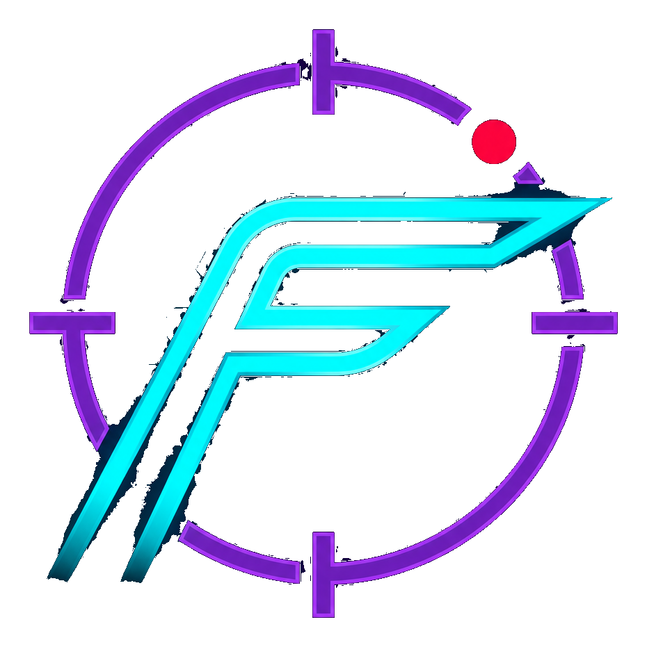

<div align="center">



# FSPEDX • SpeedX

**Full-Speed Extreme** — PES / eFootball game performance booster for budget Android phones.

**Target device:** Redmi 14C · Android 14 · MediaTek Helio G81-Ultra · 4GB RAM

</div>

---

## What It Does

FSPEDX makes PES run smoother on budget phones by combining:

- **Network** — Wi-Fi low-latency lock, local VPN with UDP priority, smart DNS
- **Performance** — 80% RAM priority lock, thermal sentinel, refresh-rate management, GPU rendering tuning, keep-screen-on
- **In-game overlays** — live FPS/temp counter, floating quick-pill, side dashboard, aiming crosshair, edge guard, interception banner
- **Analytics** — touch heatmap, mis-tap detection + K-Means button suggestions, lag-spike timeline, session recording & replay
- **Protection** — smart DND (never mutes calls), app whitelist, backup & restore

## Feature Status Summary

| # | Feature | Status |
|---|---------|--------|
| 1 | Smart Onboarding Wizard | ✅ Working |
| 2 | 80% RAM Priority Lock | ✅ Working |
| 3 | App Whitelist | ✅ Working (app picker to be polished) |
| 4 | Memory Extension Enabler | ⚠️ Opens system settings |
| 5 | Safe Cache Monitor | ✅ Working |
| 6 | FPS + Temp Overlay | ✅ Working (real Choreographer FPS) |
| 7 | Refresh Rate Switcher | ⚠️ Device-dependent |
| 8 | Thermal Sentinel | ✅ Working (auto-60Hz at critical temp) |
| 9 | Eco vs Turbo Profiles | ✅ Working |
| 10 | Auto-Launch Trigger | ✅ Working |
| 11 | Wi-Fi Low-Latency Lock | ✅ Working |
| 12 | Local VPN (UDP priority) | ✅ Working |
| 13 | Smart DNS | ✅ Working |
| 14 | Dual-Channel Rescue | ⚠️ Opens system settings |
| 15 | Pre-Match Radar (ping) | ✅ Working |
| 16 | Smart DND | ✅ Working (never cancels calls) |
| 17 | Floating Quick-Pill | ✅ Working |
| 18 | Side Pull-Out Table | ✅ Working (real data) |
| 19 | Local Backup & Restore | ✅ Working |
| 20 | Touch Heatmap Recorder | ✅ Working |
| 21 | Gesture Classification | ✅ Working |
| 22 | Mis-Tap + K-Means | ✅ Working |
| 23 | Vibration Muscle Training | ✅ Working |
| 24 | Aiming Crosshair | ✅ Working |
| 25 | Session Replay | ✅ Working (MediaProjection flow) |
| 26 | Record Toggle (Pill) | ✅ Working |
| 27 | Lag Spike Timeline | ✅ Working |
| 28 | GPU Rendering Tuning | ✅ Working (Settings.Global) |
| 29 | Gesture/Edge Blocking | ✅ Working |
| 30 | Background Data Starvation | ✅ Working |
| — | Keep Screen On | ✅ Working |
| — | Floating Notifications (banner) | ✅ Working |
| — | Message Floating Window | 📅 Phase 2 |

> Legend: ✅ fully working · ⚠️ works but device/system-dependent · 📅 planned

## Screens (18 in wireframe)

3 activities (Splash, Onboarding, Main) · 4 main fragments (Home, Features, Analytics, Gallery) ·
3 analytics sub-tabs · 2 dialogs · 6 persistent overlays.

## Tech Stack

Kotlin · AndroidX · Material Components · Room · Coroutines · MPAndroidChart ·
OkHttp · Gson · ViewBinding · minSdk 26 · targetSdk 34 · compileSdk 34

## Build

Requires: JDK 17, Gradle 8.5, Android SDK Platform 34.

```
gradle assembleDebug
# APK: app/build/outputs/apk/debug/app-debug.apk
```

## Documentation

- [`docs/README.md`](docs/README.md) — documentation index
- [`docs/ARCHITECTURE.md`](docs/ARCHITECTURE.md) — code architecture & structure
- [`docs/APP-FEATURES.md`](docs/APP-FEATURES.md) — full feature reference
- [`docs/APP-SCREENS.md`](docs/APP-SCREENS.md) — screen inventory
- [`docs/DEVELOPMENT.md`](docs/DEVELOPMENT.md) — build, install, test guide
- [`docs/product-acceptance-questions.md`](docs/product-acceptance-questions.md) — product acceptance checklist

## Project Layout

```
app/src/main/java/com/fspedx/booster/
├── FSPEDXApplication.kt        App class + auto-launch + keep-screen-on
├── ui/                         Activities, fragments, adapters, custom views
├── services/                   VPN, Overlay, Accessibility, DND, Recorder
├── viewmodels/                 MVVM state holders
├── data/                       Room database, models, repository
├── utils/                      Permissions, network, performance, ML, backup, constants
└── di/                         Manual DI (AppContainer)
```

## Notes

- Package: `com.fspedx.booster`
- **Scope for v1.0.1: PES / eFootball only** (architecture kept clean for future games)
- No emojis as UI design — vector icons only
- All UI data is real (from system/DB), never hardcoded
